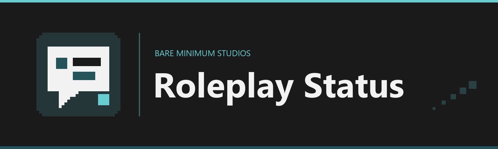
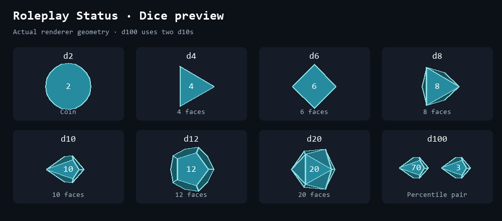
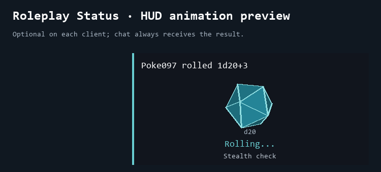
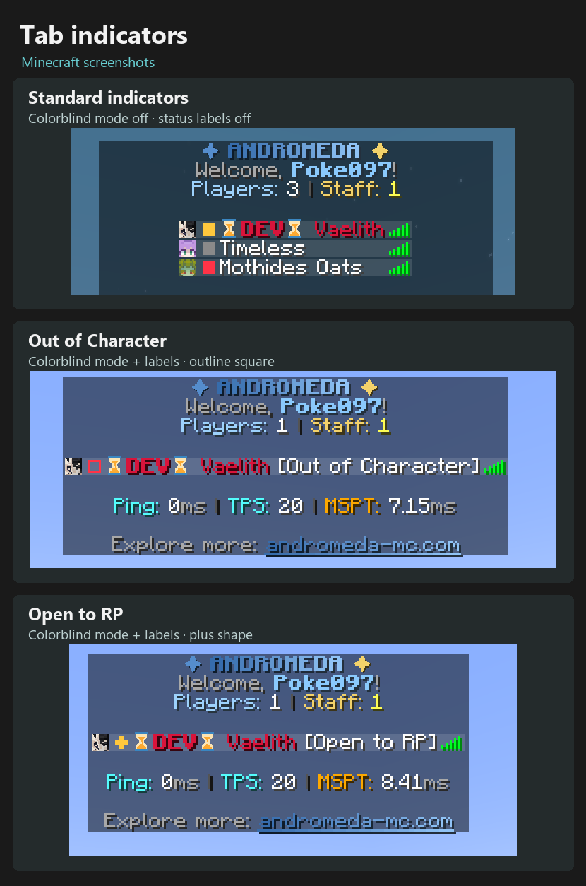

  

  <strong>Minecraft 1.21.1 · Fabric &amp; NeoForge · Java 21 · Client &amp; Server</strong> 
  <a href="https://github.com/BareMinimumStudios/roleplay-status">Source</a> ·
  <a href="https://github.com/BareMinimumStudios/roleplay-status/issues">Issues</a> ·
  <a href="https://github.com/BareMinimumStudios/roleplay-status/blob/main/CONFIGURATION.md">Configuration</a> ·
  <a href="https://discord.gg/pcRw79hwey">Discord</a>

# Roleplay Status

Share your roleplay status in the Tab player list and roll dice with nearby players. Customize status labels and colors, choose accessible indicators, and move or resize the optional dice HUD.

Created by **pokesmells / Bare Minimum Studios**. Previously named Andromeda Status.

**Version 2 is standalone. Status by Max Henkel is no longer required.**

## Choose your status

Press **U** by default (rebindable) to open the status screen. Your selection appears beside your name in the **Tab player list**.

| Status | Default indicator |
| --- | --- |
| In Character | Green square |
| Out of Character | Red square |
| Open to RP | Gold square |
| Busy / AFK | Gray square |
| Event | Purple square |
| New | Cyan square |
| Recording | Orange half-square |
| Streaming | Blue half-square |

Selections persist across server restarts. Out of Character is the default until you choose another status. A join reminder highlights your bound status key in green.

The **No Sleep** toggle excludes you from the players required to skip the night, respecting the server’s sleeping percentage rule.

## Nearby dice rolls

Roll directly in chat, with an optional reason:

| Command | What it does |
| --- | --- |
| `/roll` or `/roll d20` | Roll a twenty-sided die |
| `/roll 2d6` | Roll two six-sided dice |
| `/roll 1d20+3 Stealth check` | Add a modifier and a reason |

Supported dice: **d2, d4, d6, d8, d10, d12, d20, and d100**. Roll up to **20 dice** at once, with modifiers from **−1000 to +1000**.

The server generates every result and shares the total, individual rolls, modifier, and optional reason in chat. Results reach players within **25 blocks**, including the roller, in the **same dimension**. Operators can change the range through Fzzy Config.

*Renderer preview, not an in-game screenshot. A d2 is a coin; d100 uses two percentile d10s.*

## Optional dice animations

Nearby rolls can display a short animated dice panel on your HUD, using the matching polyhedral shapes.

Disable it through **U → Configure → Accessibility → Dice animations**. Animations are enabled by default, never affect the result, and can be turned off without hiding chat results.

The overlay previews up to four dice at a time and uses a pair of percentile dice for d100. Chat includes every individual result.

*Animation preview generated from the renderer geometry, not a recording of Minecraft.*

## Move and resize the dice panel

Open **U → Position dice** to drag a live preview away from your minimap or other HUD elements.
Use the **Dice size** slider (50–150%), then choose **Save**. **Cancel** or Escape discards edits;
**Reset** previews the top-left position at 100% size until saved.

Position and size are personal settings, also available under **Configure → Accessibility**.
They save locally and adapt to resolution and GUI scale changes. The panel automatically
fits within your screen. This does not change chat results or anyone else's HUD.

## Colorblind-friendly indicators

Enable **Colorblind mode** on the U screen or through **Configure → Accessibility**. Each status gets a distinct shape, so color is not the only way to identify it.

| Status | Colorblind shape |
| --- | --- |
| In Character | Solid square |
| Out of Character | Outline square |
| Open to RP | Plus |
| Busy / AFK | Dash |
| Event | Diamond |
| New | Triangle |
| Recording | Right half-square |
| Streaming | Left half-square |

**Show status labels** adds a gray status name beside players in Tab. It works independently of colorblind mode and is off by default.

These display preferences apply immediately, save locally, and are available to every player. They do not change other players’ settings.

*Designed comparison based on user-provided Minecraft screenshots: standard indicators, an Out of Character outline, and an Open to RP plus shape. Both colorblind examples also have optional status labels enabled.*

Unedited in-game captures: [Standard indicators](https://raw.githubusercontent.com/BareMinimumStudios/roleplay-status/main/docs/media/tab-standard-original.png) · [Colorblind: Out of Character](https://raw.githubusercontent.com/BareMinimumStudios/roleplay-status/main/docs/media/tab-colorblind-ooc-original.png) · [Colorblind: Open to RP](https://raw.githubusercontent.com/BareMinimumStudios/roleplay-status/main/docs/media/tab-colorblind-open-rp-original.png)

## Configure

Open **U → Configure** to access Fzzy Config. Server operators with permission level **2** can:

- Rename the eight statuses.
- Change colors with the color picker, presets, or hex entry.
- Enable or disable dice rolling.
- Set the sharing range from **1–256 blocks**.
- Adjust the roll cooldown, which defaults to **one second**.

Accepted in-game changes apply live. Existing saved colors are preserved when updating.

| File | Settings |
| --- | --- |
| `config/roleplay_status/statuses.json` | Status labels and colors |
| `config/roleplay_status/dice.json` | Server dice settings |
| `config/roleplay_status/accessibility.json` | Personal display preferences |

Stop the server before manually editing its JSON files, then restart to load your changes.

## Install

Use **Minecraft 1.21.1** and **Java 21**. Install the matching loader build and its dependencies on the server and every participating client.

- **Fabric:** Fabric Loader 0.19.5+, Fabric API, Fabric Language Kotlin 1.13.7+kotlin.2.2.21+, and Fzzy Config 0.7.7+1.21.
- **NeoForge:** NeoForge 21.1.266+, Kotlin for Forge 5.11.0+, and Fzzy Config 0.7.7+fix1+1.21+neoforge.

Use matching client and server loaders. Cross-loader connections are not supported.

When upgrading from the old addon, remove **Status**, **Andromeda Status**, and older **Roleplay Status** JARs. Keep your configuration files. Old Status player selections start fresh; standalone selections persist afterward.

## Credits and license

Roleplay Status began as an addon for **Status by Max Henkel**. Version 2 uses its own implementation and does not bundle or require Status.

**Fzzy Config** provides the configuration editor and synchronization.

Code and artwork use the [Bare Minimum License v1.0](https://github.com/BareMinimumStudios/roleplay-status/blob/main/LICENSE). Dependencies retain their own licenses.

## Sponsor

Use code **bareminimum** for **25% off your first month**.
