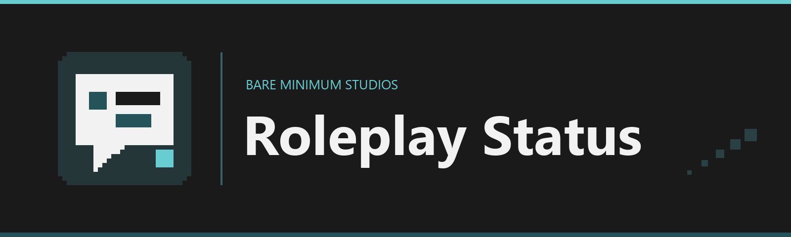

<p align="center"></p>

<p align="center">
  <a href="LICENSE"></a>
  <a href="https://github.com/BareMinimumStudios/roleplay-status/actions/workflows/build.yml"></a>
  <a href="https://github.com/BareMinimumStudios/roleplay-status/issues"></a>
</p>

<p align="center"><strong>Minecraft 1.21.1 · Fabric &amp; NeoForge · Java 21 · Client &amp; Server</strong><br>
<a href="https://modrinth.com/mod/roleplay-status">Modrinth</a> · <a href="CONFIGURATION.md">Configuration</a> · <a href="https://github.com/BareMinimumStudios/roleplay-status">Source</a> · <a href="https://discord.gg/pcRw79hwey">Discord</a></p>

# Roleplay Status

Share whether you are in character, available for roleplay, or taking a break. **Roleplay Status 2.x is standalone**, with native Fabric and NeoForge builds for Minecraft 1.21.1. Created by **pokesmells / Bare Minimum Studios**.

Press **U** (rebindable under Roleplay Status) to choose a status, toggle **No Sleep**, or open **Configure**. A status indicator appears beside each participating player's name in the Tab player list. The screen marks your current choice and shows full labels in tooltips.

| Choice | Default color |
| --- | --- |
| In Character | Green |
| Out of Character | Red |
| Open to RP | Gold |
| Busy / AFK | Gray |
| Event | Purple |
| New | Cyan |
| Recording | Orange half-square |
| Streaming | Blue half-square |

No Sleep excludes you from the players required to skip night, respecting Minecraft's sleeping percentage rule. Status and No Sleep are server-owned, saved per world, and synchronized to participating clients. Client requests cannot edit another player's status.

## Nearby dice rolls

Use `/roll` (defaults to d20), `/roll d20`, `/roll 2d6`, or `/roll 1d20+3 Stealth check`.
The reason is optional. Supported dice: d2, d4, d6, d8, d10, d12, d20 and d100;
up to 20 dice per roll, with a modifier from -1000 to +1000.

The server generates the results and shares them in chat with players within **25 blocks**
(including the roller), measured in all directions in the same dimension.
Operators can change the range (1–256 blocks), enable/disable rolling, and adjust the
one-second cooldown through **Configure → Dice rolls** in Fzzy Config.
Settings are saved in `config/roleplay_status/dice.json`.

**Configure → Accessibility → Dice animations** controls the optional local HUD animation.
It is enabled by default and can be disabled without hiding chat results. Dice use
their corresponding polyhedral shapes; d2 is a coin, and d100 uses two percentile d10s
(00 + 0 means 100). The overlay previews up to four dice at a time; chat lists every
individual result and the modifier. For multiple d100s it cycles through percentile pairs.
Animations do not affect outcomes.

## Move and resize the dice panel

Open **U → Position dice** to drag a live preview away from your minimap or other HUD elements.
Use the **Dice size** slider (50–150%), then choose **Save**. **Cancel** or Escape discards edits;
**Reset** previews the top-left position at 100% size until saved.

Position and size are personal settings, also available under **Configure → Accessibility**.
They save locally and adapt to resolution and GUI scale changes. The panel automatically
fits within your screen. This does not change chat results or anyone else's HUD.

## Colorblind mode

Toggle **Colorblind mode** on the U screen or open **Configure → Accessibility**. This client-only setting uses eight distinct shapes. **Show status labels** is a separate option in **Configure → Accessibility**, off by default. Enable it to add a gray status suffix beside names in Tab, with or without colorblind mode. It is available to every player, applies immediately, and saves locally in `config/roleplay_status/accessibility.json`. Server colors and other players' settings are unchanged.

Shapes: In Character = solid square; Out of Character = outline square; Open to RP = plus; Busy / AFK = dash; Event = diamond; New = triangle; Recording = right half; Streaming = left half.

## Install

Use **Minecraft 1.21.1** and **Java 21**. Install the matching loader build and its dependencies on the server and every participating client:

| Fabric | NeoForge |
| --- | --- |
| Fabric Loader 0.19.5+ | NeoForge 21.1.266+ |
| Fabric API 0.116.17+1.21.1 | — |
| Fabric Language Kotlin 1.13.7+kotlin.2.2.21+ | Kotlin for Forge 5.11.0+ |
| Fzzy Config 0.7.7+1.21 | Fzzy Config 0.7.7+fix1+1.21+neoforge |
| `roleplay-status-fabric-2.0.3+1.21.1.jar` | `roleplay-status-neoforge-2.0.3+1.21.1.jar` |

**Remove Status, older Roleplay Status, and Andromeda Status JARs before upgrading.** Version 2 replaces the addon with its own implementation. Keep `config/roleplay_status/statuses.json`; existing labels and colors retain their format. Legacy Andromeda labels and colors are imported when no new config exists, leaving the original file intact.

Selections stored by the former Status dependency are not imported. Players start Out of Character with No Sleep off until they choose new settings. The standalone choices then persist in `<world>/data/roleplay_status.dat`.

Fabric and NeoForge are separate builds. Cross-loader client/server connections are not a supported or tested deployment.

## Configure

Open **U → Configure**. Each of the eight statuses has a label and an opaque RGB color picker, presets, and hex entry. Editing the server configuration requires operator permission level **2**. Accepted in-game edits apply live through Fzzy Config.

Server settings are saved in `config/roleplay_status/statuses.json` and `config/roleplay_status/dice.json`. Personal settings are saved in `config/roleplay_status/accessibility.json`. Stop the server before editing server JSON manually, then restart to load it. See [CONFIGURATION.md](CONFIGURATION.md).

## Build and publish

Java 21, Python 3.11+, and the supplied **Gradle 9.9.1** wrapper are used for release checks.

```text
gradlew.bat clean build
python scripts/verify_release.py
```

Build one loader with `gradlew.bat :fabric:build` or `gradlew.bat :neoforge:build`. On Linux/macOS use `./gradlew`. Helper scripts are available as `scripts/build.ps1` and `scripts/build.sh`, taking `both`, `fabric`, or `neoforge`.

Installable JARs are written to `fabric/build/libs` and `neoforge/build/libs`. Sources JARs are for development. The Gradle build uses Kotlin DSL. Shared Kotlin lives in `src/main/kotlin`, and each loader module contains its own integration. The Java mixins handle Tab indicators, join reminder spacing, and sleep counting. Fabric uses Loom 1.17.21, NeoForge uses ModDevGradle 2.0.148, and Mixin MCP 1.5.0 remains enabled in the Fabric module.

[Build](.github/workflows/build.yml) tests each loader. [Publish](.github/workflows/publish.yml) first builds and verifies **both** JARs, then uploads a separate release for each loader to **Modrinth project v5aMEMjW** using the existing `MODRINTH_TOKEN` secret. Both use version `2.0.3+1.21.1`, with loader-specific titles and dependencies. CurseForge uploads remain disabled. See [RELEASING.md](RELEASING.md) and the [validation notes](docs/VALIDATION.md). Storefront copy is available in [MODRINTH.md](MODRINTH.md) and [CURSEFORGE.md](CURSEFORGE.md).

## Credits and license

Roleplay Status originally began as an addon for Status by Max Henkel. Version 2 provides its own implementation and contains no Status code, assets, packets, or runtime dependency. Fzzy Config supplies the configuration editor and synchronization.

Code and artwork use the [Bare Minimum License v1.0](LICENSE). Dependencies retain their own licenses; see [NOTICE.md](NOTICE.md).
