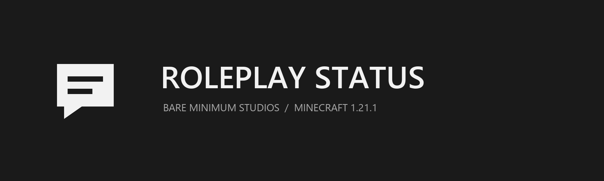

  
  
  

<strong>Minecraft 1.21.1 · Fabric · Java 21 · Client &amp; Server</strong> 
<a href="https://modrinth.com/mod/roleplay-status">Modrinth</a> · <a href="CONFIGURATION.md">Configuration</a> · <a href="https://github.com/BareMinimumStudios/roleplay-status">Source</a> · <a href="https://discord.gg/pcRw79hwey">Discord</a>

# Roleplay Status

Let other players know whether you are in character, available for roleplay, or taking a break. Roleplay Status adds eight roleplay-focused choices and a clean replacement screen to [Status by Max Henkel](https://modrinth.com/mod/status).

Created by **pokesmells / Bare Minimum Studios**. Previously named Andromeda Status.

## Choose your status

Press **U** by default (or your rebound Status key), select a status, and return to the game. Your selected choice is marked on the screen; the colored indicators are supplied through Status's existing display system.

| Choice | Default color |
| --- | --- |
| In Character | Green |
| Out of Character | Red |
| Open to RP | Gold |
| Busy / AFK | Gray |
| Event | Purple |
| New | Cyan |
| Recording | Red |
| Streaming | Violet |

Out of Character is the fallback. The original **No Sleep** setting remains available. The replacement screen opens before the original Status screen initializes, adapts to narrow windows, and shows full labels in tooltips.

## Install

Install these mods on **both the server and every client**:

- Fabric API for Minecraft 1.21.1.
- Status **1.21.1-1.0.8** by Max Henkel.
- [Fzzy Config **0.7.7+1.21**](https://modrinth.com/mod/fzzy-config/version/0.7.7+1.21) and its required dependencies (including Fabric Language Kotlin).
- Fabric Language Kotlin **1.13.7+kotlin.2.2.21 or newer**.
- Roleplay Status **1.0.7+1.21.1**.

Use **Fabric Loader 0.19.5 or newer** and **Java 21**. Remove the old Andromeda Status JAR when updating. This release supports Fabric; other loaders are not supplied.

## Configure

Click **Configure** on the status screen to open the Fzzy Config editor. Each status has a **Label** and a **Color**, including a color picker, presets, and hex entry. Server operators with permission level **2** can submit changes; Fzzy Config applies accepted edits live and synchronizes them to players.

The server file is `config/roleplay_status/statuses.json`. See [CONFIGURATION.md](CONFIGURATION.md) for examples, validation, and migration. Edit the JSON while the server is stopped, then restart; in-game changes apply without a restart.

Existing `config/andromeda_status/statuses.json` labels and colors are imported when no new config exists. The original file is preserved. Old roleplay state IDs are mapped to the new namespace.

## Build and release

Run `./gradlew build` (Windows: `gradlew.bat build`) with Java 21. Gradle **9.8.0** is supplied by the wrapper. Loom **1.17.21** is the stable Java 21-compatible build plugin. Mixin MCP **1.5.0** is enabled for dependency-source inspection; run `./gradlew genDependencySources` after importing the project in IntelliJ.

The installable file is `build/libs/roleplay-status-1.0.7+1.21.1.jar`. The sources JAR is for development.

[Build](.github/workflows/build.yml) verifies changes automatically. [Publish](.github/workflows/publish.yml) is manually dispatched and uploads the verified release to **Modrinth project `v5aMEMjW` only**, using the repository secret `MODRINTH_TOKEN`. See [RELEASING.md](RELEASING.md).

## Credits and license

Status remains a required external dependency. Roleplay Status does not include or redistribute its JAR, code, or assets. Fzzy Config supplies the configuration UI, validation, permissions, and synchronization.

Roleplay Status code and artwork use the [Bare Minimum License v1.0](LICENSE). Dependencies retain their own licenses; see [NOTICE.md](NOTICE.md).

The mod implementation is written in Kotlin. The four small integration mixins remain in Java for compatibility with Status and Minecraft.
